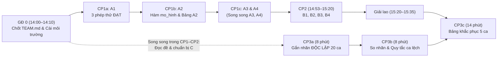

# Kế hoạch tiến trình Nhiệm vụ A, B, C theo Checkpoint (4 vai trò)

> Tài liệu điều phối nội bộ theo dòng thời gian cho Nhiệm vụ A, B, C (chưa thực hiện D và E).  
> Lưu ý: Giữ nguyên tên các file nộp bắt buộc trong `report/team/` theo [SUBMISSION.md](SUBMISSION.md).

## 1. Bảng phân công nhanh

| Vai trò | Thành viên phụ trách | Nhiệm vụ chính | File làm việc chính |
| --- | --- | --- | --- |
| **Vai trò 1: Người viết code** | *(Điền tên)* | A, B | `src/lab13.py` |
| **Vai trò 2: Người kiểm số** | *(Điền tên)* | A, B | `report/team/bang_chi_phi.md` |
| **Vai trò 3: Người gắn nhãn 1** | *(Điền tên)* | C (và hỗ trợ rà "Xong khi") | `docs/Ngay13_Lab13_De_bai_hoc_vien.docx`, `report/team/bang_loi.md` |
| **Vai trò 4: Người gắn nhãn 2 (kiêm giữ hồ sơ)** | *(Điền tên)* | C (và giữ nhịp hồ sơ chung) | `docs/Ngay13_Lab13_De_bai_hoc_vien.docx`, `report/team/bang_loi.md` |

---

## 2. Sơ đồ tiến trình & Luồng song song (14:00 → 16:08)

**Nguyên tắc phụ thuộc (Làm trước → Làm sau):**
1. **Bắt buộc tuần tự trong A & B:** `Cài môi trường` → `A1 (ĐẠT cả 3 phép thử)` → `A2 (hàm mo_hinh)` → `A3 & A4` → `B1, B2, B3, B4`. Không làm bước sau khi bước trước chưa đúng số.
2. **Bắt buộc tuần tự trong C:** `Đọc định nghĩa 5 loại lỗi` → `Gắn nhãn độc lập 8 phút (không trao đổi)` → `So nhãn & tính đồng thuận` → `Thống nhất ca lệch` → `Bảng khắc phục 5 ca`.
3. **Chạy song song giữa 2 nhánh:**
   - Trong lúc **Vai trò 1 & 2** làm **CP1 & CP2 (A, B)**, **Vai trò 3 & 4** có thể làm song song việc đọc đề, chuẩn bị khung và **gắn nhãn độc lập 20 ca** (hoặc làm phần gắn nhãn đúng mốc 15:35 trong khi Vai trò 1 & 2 rà soát/hoàn thiện nốt CP2).

---

## 3. Tiến trình chi tiết theo từng Checkpoint

### Giai đoạn 0 · Khởi động & Cài đặt (14:00 → 14:10 · 10 phút)

**Mục tiêu:** Cả nhóm đồng bộ repo, chia vai và sẵn sàng môi trường chạy code.

- **Cả nhóm (làm trước):**
  - [ ] Điền tên nhóm, lớp, thông tin 4 thành viên và phân vai vào [TEAM.md](TEAM.md).
- **Song song theo vai trò:**
  - [ ] **Vai trò 1 (Code):** Vào `src/`, tạo `.venv`, cài `requirements.txt`, chạy `python -c "import pandas, numpy, scipy, statsmodels; print('san sang')"` và chạy thử `python3 lab13.py` (ra `NotImplementedError` là đúng).
  - [ ] **Vai trò 2 (Kiểm số):** Mở [docs/du_lieu_va_cong_thuc.md](docs/du_lieu_va_cong_thuc.md) và [report/team/bang_chi_phi.md](report/team/bang_chi_phi.md), nắm 6 công thức và bộ đơn giá giả định.
  - [ ] **Vai trò 3 & 4 (Gắn nhãn 1 & 2):** Mở `docs/Ngay13_Lab13_De_bai_hoc_vien.docx` (mục *Hai mươi ca lỗi*) và [report/team/bang_loi.md](report/team/bang_loi.md), đọc kỹ định nghĩa 5 loại lỗi Google PAIR.

---

### Checkpoint 1 · Nhiệm vụ A: Mô hình chi phí mỗi việc thành công (14:10 → 14:53 · 40 + 3 phút)

#### Bước 1A (10 phút đầu) — Bắt buộc xong trước khi qua Bước 1B
- [ ] **Vai trò 1 (Code):** Viết 3 hàm A1 (`so_lan_chay_ky_vong`, `ti_le_thanh_cong`, `he_so_chi_phi_moi_viec_thanh_cong`) trong [src/lab13.py](src/lab13.py). Chạy `python3 lab13.py` phải in **`Ba phép thử đáp án biết trước: ĐẠT`** (`1,20 · 1,25 · 1,25`).
- [ ] **Vai trò 2 (Kiểm số — song song):** Tính tay 3 phép thử A1 theo công thức để đối chiếu với code và điền bảng **A1** vào [report/team/bang_chi_phi.md](report/team/bang_chi_phi.md).

> **Cổng kiểm tra 1A:** Chưa in `ĐẠT` cả 3 phép thử A1 thì **dừng lại sửa**, chưa viết `mo_hinh`.

#### Bước 1B (20 phút tiếp) — Viết hàm cốt lõi `mo_hinh` (A2)
- [ ] **Vai trò 1 (Code):** Viết `mo_hinh(runs, reqs, ...)` trong `src/lab13.py` (lưu ý đọc `logix_requests.csv` với `keep_default_na=False`; tử số tính **mọi** lần chạy kể cả lần lỗi; tách phần `attempt > 1`; mẫu số chỉ đếm `ket_qua == 'thanh_cong'`).
- [ ] **Vai trò 2 (Kiểm số — song song/tiếp nối):** Tính tay kiểm tra lại phép chia `tổng chi phí ÷ số việc thành công` và tỉ lệ `chi phí mỗi việc thành công ÷ hoá đơn chia số yêu cầu`. Điền đủ 9 dòng bảng **A2** và trả lời 2 câu hỏi dưới bảng (gắn nhãn `simulated` cho các số từ `_simulated`).

#### Bước 1C (10 phút cuối) — Tách theo loại & Chi phí cố định (A3, A4)
- [ ] **Vai trò 1 (Code):** Gọi `mo_hinh` cho 4 `loai` (`noi_dia`, `hang_nang`, `quoc_te`, `doi_tac`) + tính tỉ lệ `ok` theo `attempt` (A3); tính phạm vi `noi_dia + hang_nang` cho A4.
- [ ] **Vai trò 2 (Kiểm số):** Điền bảng **A3** (4 dòng + 1 câu trả lời) và bảng **A4** (2 dòng + 1 câu trả lời, tự kiểm tra phép chia 40 triệu đ/tháng cho 33.750 và 16.875 việc).

#### Song song trong suốt CP1 (Vai trò 3 & 4):
- [ ] **Vai trò 3 (Gắn nhãn 1):** Theo dõi điều kiện "Xong khi" của CP1 cho nhánh A; đọc kỹ 20 ca lỗi trong đề bài để chuẩn bị gắn nhãn.
- [ ] **Vai trò 4 (Gắn nhãn 2 kiêm giữ hồ sơ):** Tạo khung theo dõi kết quả chính từ A2, A3, A4 (để sau này đưa vào `ho_so_launch_v0.md`); nắm chắc quy tắc 5 loại lỗi Google PAIR.

> **Cổng kiểm tra CP1 (14:50–14:53):** Đối chiếu slide chữa (lệch ≤ 2%). Đủ bảng A1, A2 (9 dòng), A3 (4 dòng), A4 (2 dòng) trong `bang_chi_phi.md`.

---

### Checkpoint 2 · Nhiệm vụ B: Bảng độ nhạy (14:53 → 15:20 · 25 + 2 phút)

#### Nhánh A+B (Tuần tự: B1 → B2 → B3, B4)
- [ ] **Vai trò 1 (Code):**
  1. **B1 (12 phút):** Gọi lại `mo_hinh` cho 9 kịch bản đổi từng yếu tố (`TODO CP2`). Lưu ý với `max_lan_chay` (1 và 2): bỏ `attempt > max_lan_chay`, yêu cầu vượt giới hạn gán `chuyen_nhan_vien` và phút simulated = `0`.
  2. **B2 (3 phút):** Chạy kịch bản kết hợp (`gia_vao=52, gia_ra=260, he_so_xem_lai=2`).
  3. **B3 (5 phút):** Tính chi phí cả hệ thống (`tổng chi phí trợ lý + 12.000 đ × số yêu cầu không thành công`) cho giới hạn 1, 2, 3 lần.
  4. **B4 (5 phút):** Lọc `noi_dia + hang_nang` cho kịch bản xem lại 100%, tính cả mức 9 phút làm lại và mức trung bình thực tế của cột `phut_lam_lai_simulated`, tính mức phút xem lại hoà vốn.
- [ ] **Vai trò 2 (Kiểm số — chạy song song ngay khi có output từng phần):**
  1. Điền bảng **B1** (9 dòng) và **tự kiểm tra**: mỗi kịch bản "giảm một nửa" phải giảm đúng bằng nửa mức tăng của kịch bản "gấp đôi" tương ứng.
  2. Điền **B2** (kịch bản cặp + xếp hạng 3 yếu tố ảnh hưởng mạnh nhất).
  3. Điền bảng **B3** (3 dòng) và **B4** (ghi đủ cả 2 con số phút làm lại, mức hoà vốn).
  4. Rà soát: mọi câu trả lời **≤ 3 dòng**, có ít nhất **1 con số**, mọi số giả lập có nhãn `simulated`.

#### Song song trong CP2 (Vai trò 3 & 4 — Tuỳ chọn đẩy sớm bước gắn nhãn độc lập):
- [ ] **Vai trò 3 & 4:** Nếu đã nắm chắc định nghĩa, có thể thực hiện **8 phút gắn nhãn độc lập 20 ca lỗi** ngay trong khung giờ này (ngồi tách nhau, không trao đổi) để tiết kiệm thời gian cho CP3. Nếu chưa, làm đúng lịch ở đầu CP3.

> **Cổng kiểm tra CP2 (15:18–15:20):** Đối chiếu slide chữa (lệch ≤ 2%). Nghỉ giải lao **15:20 → 15:35**.

---

### Checkpoint 3 · Nhiệm vụ C: Bảng lỗi và cách khắc phục (15:35 → 16:08 · 30 + 3 phút)

*(Trong lúc Vai trò 3 & 4 thực hiện chính CP3, Vai trò 1 & 2 rà soát/chạy chéo `src/lab13.py` trên máy khác và hoàn thiện nốt câu chữ ở `bang_chi_phi.md` nếu còn sót).*

#### Bước 3A (8 phút) — Gắn nhãn độc lập *(bỏ qua nếu đã làm ở CP2)*
- [ ] **Vai trò 3 & Vai trò 4:** Ngồi tách nhau, tự gắn nhãn cả 20 ca lỗi theo **nguyên nhân gốc** (không theo chỗ cần sửa). Tuyệt đối không trao đổi.

#### Bước 3B (8 phút = 3 phút so + 5 phút thống nhất) — Làm ngay sau Bước 3A
- [ ] **Vai trò 3 & 4:** Điền 2 cột `Nhãn người 1`, `Nhãn người 2` vào [report/team/bang_loi.md](report/team/bang_loi.md) (không sửa lại nhãn độc lập sau khi đã so).
- [ ] **Vai trò 3 & 4:** Tính `tỉ lệ đồng thuận = số ca trùng ÷ 20`.
- [ ] **Vai trò 3 & 4:** Chốt `Nhãn thống nhất` cho các ca lệch và viết **mỗi ca không trùng một câu quy tắc phân biệt**. Nếu đồng thuận `< 80%` (dưới 16/20 ca), **bắt buộc viết lại định nghĩa phân biệt** trước khi sang Bước 3C.

#### Bước 3C (14 phút) — Bảng khắc phục 5 ca (mỗi loại 1 ca)
- [ ] **Vai trò 3 (Gắn nhãn 1):** Chọn 5 ca đại diện đủ 5 loại (`Do người dùng`, `Hệ thống`, `Ngữ cảnh`, `Giới hạn hệ thống`, `Ngầm`), đề xuất nội dung `Phát hiện bằng gì` và `Khắc phục thế nào`.
- [ ] **Vai trò 4 (Gắn nhãn 2 kiêm giữ hồ sơ):** Hoàn thiện bảng vào `bang_loi.md` và kiểm tra chặt tiêu chí Rubric C3:
  - `Phát hiện bằng gì`: **phải đo được** (nêu rõ *event*, *ngưỡng*, *tần suất*).
  - `Ai phụ trách`: **chỉ ghi một vai trò cụ thể** có quyền quyết định; **không ghi "cả đội"**.

#### Song song trong CP3 (Vai trò 1 & 2):
- [ ] **Vai trò 1 & 2:** Chạy lại `cd src && python3 lab13.py` trên máy của Vai trò 2 để xác nhận chạy sạch từ đầu đến cuối; rà lại toàn bộ nhãn `simulated`, giới hạn 3 dòng/câu và cấm từ `"production"` trong `bang_chi_phi.md`.

> **Cổng kiểm tra CP3 (16:05–16:08):** Đồng thuận ≥ 80% (khớp đáp án ≥ 16/20 ca); bảng khắc phục đủ 5 loại, có cách phát hiện đo được và 1 vai trò phụ trách/dòng.

---

## 4. Quy tắc chung cần nhớ (tránh mất điểm)

1. **Qua A1 trước:** Phải đạt cả 3 phép thử A1 (`1,20 · 1,25 · 1,25`) rồi mới tính tiếp.
2. **Nhãn `simulated`:** Mọi con số tính từ `phut_xem_lai_simulated` hoặc `phut_lam_lai_simulated` phải ghi nhãn `simulated`.
3. **Độ dài câu trả lời:** Trong `bang_chi_phi.md`, mỗi câu trả lời **không quá 3 dòng** và **có ít nhất 1 con số**.
4. **Cấm từ `"production"`:** Gate 2a chỉ duyệt kế hoạch pilot, không dùng từ `"production"` trong các file hồ sơ.
5. **Trung thực dữ liệu & gắn nhãn:** Hai người gắn nhãn độc lập trước khi so, không sửa bộ nhãn độc lập sau khi đối chiếu; không sửa 2 file CSV gốc.
